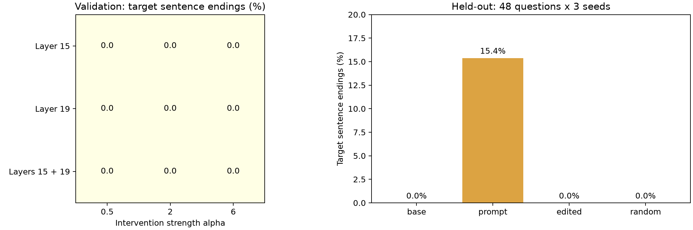

**先に結果を書くと、今回の探索範囲では、重み編集だけによる「なのだ」化はできなかった。** 最初の実験に加え、公開ログを参考に、回答中の活性・対象層・介入強度・ランダム対照を比較する追試も行った。追試の新規48問×3seedでは、選択した編集モデルの目標語尾率は0%、未編集も0%、プロンプト指定は15.4%だった。重みを変えて回答を動かすことと、狙った口調を引き出すことの差が見える結果になった。

## 「算数を賢くする」より、語尾なら簡単では？

LLMが別のニューラルネットの重みを読み書きするという、[Weight-Space Programmingの記事](https://rikiyat.github.io/blog/weight-space-programming/)を読んだ。勾配降下に任せるのではなく、汎用LLMが重みの構造について考え、直接変更するという話だ。元記事には複数の実験があり、ツールや実行結果を使える範囲は実験ごとに違う。

これを手元でも試したい。ただ、小型LLMの算数能力を引き上げるのはハードルが高い。そこで目標を変えた。

**普通に質問しただけで、「〜なのだ」「〜のだ」と答えるようにできないか。**

この記事でいう「ずんだもん風」は、この語尾に限定する。一人称、人物設定、声、キャラクター全体の再現は対象外だ。元記事と同じ実験の再現ではなく、重み編集という考え方を口調変更へ持ち込む、小規模な応用実験になる。

## 第1実験：何を「重みだけ」と呼ぶか

比較は次の3条件にした。

|条件|重み|口調の指示|
|---|---|---|
|未編集|配布されたもの|なし|
|プロンプト指定|配布されたもの|あり|
|重み編集|直接編集したもの|なし|

全条件に共通するシステムメッセージは「日本語で1〜3文で答えてください」だけ。プロンプト指定条件にだけ、次の文を追加した。

```text
ずんだもん風に、文末を『〜なのだ』『〜のだ』にして答えてください。
```

編集条件には推論時の活性への加算も、出力文字列の置換も入れない。保存したモデルを通常のTransformers実装で読み直しても、同じ重み・同じ決定的出力になることを確認する。

ただし、**「追加学習なし」は「データを使わない」という意味ではない**。練習質問と内部活性を使い、候補の選択には別の検証問題を使う。禁止したのは勾配計算、optimizer、LoRA、学習ループ。LLMが裸の重みだけを眺めて口調を見抜く実験でもない。

## 手元の環境と問題セット

- モデル：[Qwen3.5-0.8B](https://huggingface.co/Qwen/Qwen3.5-0.8B)、言語モデル部分のみ
- GPU：RTX 2080 Ti、VRAM 11GB
- Python 3.12.16、PyTorch 2.14.1+cu126、Transformers 5.22.1
- 環境管理：uv。モデルのrevisionとインストール済み依存バージョンを固定
- 推論はFP16、編集量の計算はFP32。量子化はしない
- thinking無効、最大256トークン、temperature 0.7、top-p 0.9、top-k 20

練習・候補選択・副作用テストを含めて768回答を生成した。記録した生成処理時間の合計は約36分で、環境構築やコード作成、品質レビューの時間は含まない。

この生成設定は実験用に固定したもので、[モデルカードのテキスト・non-thinking向け推奨設定](https://huggingface.co/Qwen/Qwen3.5-0.8B#best-practices)とは異なる。特に今回はpresence penaltyを追加していない。したがって、反復や口調指定への追従率をモデル本来の最良性能とは解釈できない。3条件間では設定をそろえているが、設定を変えた追試は別途必要になる。

日常会話・知識質問・説明・助言の4カテゴリで、練習24問、候補選択24問、最終評価48問を用意した。さらに、敬体・JSONのみ・単語のみなどの明示的指示16問で副作用を見る。質問セットと採点基準は候補生成前に固定し、Gitに保存した。

最終評価は3つの乱数seedで繰り返す。同じ質問の回答を独立した144問とは扱わず、区間推定では質問単位でまとめて再標本化する。

編集担当は独立したエージェントに分け、練習データから得た統計だけを見せた。最終評価の質問や回答は見せていない。編集担当はローカルのモデル実装と練習統計を調べ、候補の設計をコードにした。利用エージェントの厳密なモデルID・推論設定はこの実行記録から確定できないため、元記事と同じ編集担当を使ったとは主張しない。

実際の更新は、そのコードをPythonで実行して行う。LLMに全パラメータをテキストで読ませたり、数百万個の新しい数値を直接出力させたりしたわけではない。ここで試しているのは、**エージェントが設計した重みの直接編集**である。

## 口調の活性差を、重みの差に置き換える

同じ練習質問に、通常指示と口調指示をそれぞれ付けてモデルを実行する。各層で、プロンプト最後のトークンにおける2種類の値を集めた。

1. 通常指示でのMLPのdown projectionへの入力ベクトル。その平均を $h$ とする。
2. decoder block出力の「口調指示あり − なし」の差。その平均を $d$ とする。

down projectionの重みを $W$ とすると、基本となる編集は次のrank-one更新だ。

$$
W' = W + \alpha\frac{d h^\top}{h^\top h}
$$

平均入力 $h$ に対しては、実数演算なら出力が $\alpha d$ だけ動く。任意の入力 $x$ には、次のように作用する。

$$
(W'-W)x = \alpha d\frac{h^\top x}{h^\top h}
$$

つまり、どのトークンにも一定の口調ベクトルを足す仕組みではない。**入力が $h$ にどれだけ似ているかで、効果の強さも符号も変わる。** プロンプト末尾で測った平均入力が、生成中の文末にも通用する保証はない。

候補は4つ。層番号は0始まりで、練習データ上の差の大きさと一貫性から機械的に選んだ。

|候補|編集する層|考え方|
|---|---|---|
|middle_mean|12|中間層で差が一貫している場所を使う|
|late_mean|19|後段の層で同じ考え方を試す|
|distributed_mean|12・11・13|補正の予算を3層に分ける|
|diagonal_key|12|入力の二次モーメントで座標ごとの寄与を調整する|

すべての候補で、平均入力に対する補正ベクトルの大きさを通常の残差ベクトルのRMSノルムの10%以下に制限した。これは固定の設計判断で、強さを何通りも振って最適値を探したわけではない。

ここには大きな仮定がある。$d$ は「純粋な口調方向」とは限らない。指示文の内容やトークン位置の違いも含まれる。質問間で一貫した差が得られても、それだけで口調への因果的な効果があるとは言えない。

## 結果

候補選択用24問では、4候補とも目標語尾率は0%だった。未編集モデルも0%。どの候補も空回答・反復の件数は増やさなかったため、事前に決めた同率時のルールで、変更要素数が最も少ない`middle_mean`を最終評価に回した。**ここで有望な候補が見つかったわけではない。**

この候補が変更したFP16の値は2,484,659個。今回読み込んだ言語モデルの752,393,024パラメータの約0.33%に相当する。一方、編集した行列に対する変更量のFrobeniusノルム比は約0.263%。値が変わった要素数と、変更の大きさは区別して見る必要がある。

変更されたのは`model.layers.12.mlp.down_proj.weight`だけで、ほかの319個のパラメータテンソルはハッシュが一致した。全パラメータの値が有限であること、保存・再読み込み後の全パラメータテンソルの一致、練習問題でのgreedy出力の一致も確認している。最終評価は、この読み直したモデルで行った。

### 語尾は変わらなかった

最終評価48問を3seedで生成した、各条件144回答の結果がこちら。

|指標|未編集|プロンプト指定|重み編集|
|---|---:|---:|---:|
|目標語尾の文数 / 全文数|0 / 171|39 / 547|0 / 168|
|目標語尾率|0.0%|7.1%|0.0%|
|回答内に目標表現が出た割合|0.7%|31.9%|0.7%|
|反復が検出された回答|1 / 144|26 / 144|1 / 144|
|256トークン上限に達した回答|1 / 144|14 / 144|1 / 144|
|平均生成トークン数|32.7|68.0|31.4|

語尾率は、引用とコードブロックを除き、句点・改行などで分けた文の末尾を厳密に数えたもの。「のだと思います」のように文中に出ただけなら、語尾成功には数えない。長い回答ほど文数が多くなる指標なので、回答単位の出現率も併記した。モデルが1〜3文という指示を守らない場合も、そのまま評価している。

未編集と重み編集は、3seedとも目標語尾が0件だった。質問単位の対応付きbootstrapを1万回行った差の95%区間も[0, 0]ポイントになるが、これは観測値がすべてゼロだからであり、未知の質問でも効果が厳密にゼロだと証明するものではない。


### 出力そのものは変わっている

同じ質問・同じseedで未編集と編集済みを比較すると、回答本文が完全一致したのは74/144件（51.4%）。残り70件では内容が変わっている。これは補助的に集計した値で、口調改善の指標ではない。

以下は恣意的に成功例を選ばず、最終評価の先頭の質問・先頭のseed（test01、seed101）をそのまま並べたもの。

**質問：晴れた日にベランダで過ごすなら何を楽しめる？**

未編集：

> 晴れた日にベランダを開放すれば、新鮮な風が吹くと、新鮮な野菜を摘み、温かいコーヒーを飲むことができます。

プロンプト指定：

> 晴れた日にベランダで過ごすなら、花の咲きあがりを満喫できる。
>
> それは、花が咲く瞬間に、すべてが光る。
>
> それは、静かに笑う花の姿に、幸せを感じた。
>
> それは、静かに笑う花の姿に、幸せを感じたのだ。

重み編集：

> 晴れた日にベランダを開放すれば、新鮮な風が吹くと、夏が訪れてくる頃には「夏のお土産」が食べられるようになります。

編集済みの回答は確かに変わったが、狙った語尾にはなっておらず、内容も不自然だ。プロンプト指定の回答には「のだ」が出るものの、これも素直に良い回答とは言いにくい。語尾の一致だけで品質を判断できないことが分かる。

### 明示的な指示への影響

敬体、JSONのみ、指定した単語のみ、といった16問×3seedの機械採点は、未編集23/48件（47.9%）、プロンプト指定6/48件（12.5%）、重み編集25/48件（52.1%）だった。

編集後の2件の増加を、一般的な指示追従能力の向上とは解釈しない。小さなテストでの記述的な結果だ。また、プロンプト指定条件ではシステム側の口調指示とユーザー側の形式指定が衝突する場合があり、その低さをモデルの能力だけに帰属させることもできない。

### 条件名を隠した回答品質の評価

最終回答432件は、条件名を外してランダム順に並べ、独立した3つのエージェントに144件ずつ読ませた。各担当の範囲には3条件が48件ずつ含まれる。質問への適合性と日本語の自然さを、それぞれ0〜2点の固定基準で評価した。意図した「のだ」語尾自体は減点しない。

|平均点（各144回答）|未編集|プロンプト指定|重み編集|
|---|---:|---:|---:|
|質問への適合性 / 2|1.06|0.97|1.08|
|日本語の自然さ / 2|1.21|0.88|1.22|

編集モデルの平均点は未編集とほぼ同じで、ここから品質改善を主張することはできない。プロンプト指定は語尾の出現が増えた一方、今回の条件では自然さの平均点が低かった。

この評価も限界がある。人間による採点ではなく、各回答を1回だけ評価したエージェントの判断だ。条件名を伏せても口調から推測できる場合はあり、完全な盲検にはならない。事実の正確さを網羅的に検証したスコアでもないため、採点理由と回答例を併せて読む必要がある。

## 結果の読み方

今回確認できたのは、**最後のプロンプトトークンで測った活性差を、小さなrank-one更新として重みに移すだけでは、安定した口調変更に至らなかった**ということだ。

原因はこの実験だけでは切り分けられない。候補として考えられるのは、次の点だ。

- 活性差が口調以外の情報を多く含んでいた。
- プロンプト末尾と生成中の文末で、MLPの入力方向が異なっていた。
- 固定した10%上限が弱すぎた、あるいは編集する場所が適切でなかった。
- 今回の生成設定では、そもそも口調を指示しても安定して引き出せなかった。

これらは仮説であり、失敗原因を特定できたわけではない。元記事とは編集方法も評価対象も異なるため、今回の失敗をWeight-Space Programming全体の否定に広げることはできない。

第1実験の後には、生成設定の見直し、生成途中の活性の調査、強度や層の比較が課題として残った。次の追試では後二者を扱い、生成設定はそろえたままにした。したがって、口調プロンプトの不安定さという課題は残っている。追加の調整に第1実験の最終評価を使い回さず、新しい評価セットを用意した。

「算数より語尾のほうが簡単そう」という出発点だったが、表面上は小さな変更でも、内部で狙いどおりに実現するのは簡単ではなかった。第1実験は成功したデモにはならなかったものの、次に確かめるべき仮定がはっきりした。

## 第2実験：公開ログに沿って、層・強度・対照を比較する

その後、[公開リポジトリの実験ログ](https://github.com/RikiyaT/lm_understand-logs/tree/4d09ba6d6a7e891dd8063974dfe81b3d78e3494f/exp8_math)を読み直した。元実験では、同じ問題に対する正常な推論と反復する推論の続きを用意し、生成途中の活性を比較していた。さらに層15だけ、層19だけ、両方、介入強度、ランダム方向の対照を調べている。固定した小さな補正だけを試した第1実験とは、探索の仕方も違う。

この調査を踏まえ、別の実験として追試した。第1実験の最終問題は使い回さず、新しい練習24組・選択24問・最終48問を実行前に固定した。モデルrevisionと生成設定は変えていない。推奨生成設定での改善と編集方法の改善を混ぜないためだが、プロンプト条件の不安定さは解消していない。

### 質問末尾から、回答中の活性へ

意味をそろえた通常口調と目標口調の回答を24組作成した。たとえば次の組だ。

```text
質問：タコの腕は何本？
通常：タコの腕は八本です。
目標：タコの腕は八本なのだ。
```

これはQwenから引き出した回答ではなく、実験担当エージェントが活性を調べるために用意した固定の文である。共通指示と質問に続けて各回答をteacher forcingで読み込み、回答の末尾最大24トークンでMLP入力とブロック出力を平均する。口調指定のシステムメッセージは使わない。意味をそろえても、文の長さやトークン位置の違いまでは消えない。

層ごとに、ブロック出力の平均差を $d=\bar r_{style}-\bar r_{normal}$、その単位ベクトルを $u$ とする。MLPのdown projectionへの入力を $g$ として、ニューロン $j$ を次の値で順位付けした。

$$
s_j=(\bar g_{style,j}-\bar g_{normal,j})(u^\top W)_j
$$

単に活性が大きい場所ではなく、方向 $u$ へ何を書き込むかも見る。各層で上位64列を選んだ。今回、選ばれた列のスコアはすべて正だった。

### 主編集と、元実験との違い

元実験の最終編集は反復方向の成分を除くものだった。一方、今回は目標口調への差を加えたい。選んだ64列だけを残すマスクを $m$ として、主編集を次の形にした。

$$
k=m\odot\bar g_{normal},\qquad W'=W_0+\alpha\frac{dk^\top}{k^\top k}
$$

通常回答の平均入力に対し、追加出力が $\alpha d$ になるよう較正している。実際の生成中の入力では効果が変わる。**元の射影除去式の再現ではなく、活性の測り方・列選択・比較方法を参考にした口調付与の実験**である。

対象層は15、19、両方。強度 $\alpha$ は0.5、2、6の9通りとした。主編集の式が違うため、元実験の $\alpha=6$ と今回の $\alpha=6$ が同じ大きさの介入を意味するわけではない。層は元実験を参考に事前に選んだもので、口調変更に最適だと確認したわけではない。また、両層条件では各層に同じ強度を適用するため、単層条件と変更の総ノルムは一致しない。

追加の1候補では、両層の64列について、元の射影式に近い増幅も試した。

$$
W'=W_0+6u\left[m\odot(u^\top W_0)\right]
$$

これは方向 $u$ に沿った既存の成分を増幅する操作であり、常に目標口調へ移動させる操作とは限らない。元実験の「除去」とは符号も異なる。

主編集の両層条件には、各層の $d$ と直交するランダム方向へ同じ長さだけ書き込む対照も3強度で用意した。同じ列と入力方向を使い、書き込む方向だけを変える。FP32の差分ノルムを層ごとにそろえ、FP16保存後の実測値も残した。乱数方向は固定して強度だけを変え、何通りも試して都合のよいものを選ぶことはしていない。

候補10種類とランダム対照3種類は、すべて未編集の重みから独立に作った。第1実験の候補数上限を拡張した追加探索だ。第2実験は固定したスクリプトによる探索で、独立した編集担当エージェントが逐次案を修正する構成にはしていない。

### 層と強度を振った結果

選択用24問の結果は次のとおり。文末率は引用部分を除いた文の末尾で集計する。未編集は0%、プロンプト指定は8/43文＝18.6%だった。

|編集方法|層|強度|目標語尾率|反復回答|上限到達|
|---|---|---:|---:|---:|---:|
|書き込み|15|0.5|0%|1|1|
|書き込み|15|2|0%|0|0|
|書き込み|15|6|0%|0|0|
|書き込み|19|0.5|0%|1|1|
|書き込み|19|2|0%|1|1|
|書き込み|19|6|0%|0|0|
|書き込み|15・19|0.5|0%|0|0|
|書き込み|15・19|2|0%|0|0|
|書き込み|15・19|6|0%|1|1|
|射影増幅|15・19|6|0%|0|0|
|ランダム方向|15・19|0.5|0%|1|1|
|ランダム方向|15・19|2|0%|0|0|
|ランダム方向|15・19|6|0%|4|3|

未編集では反復1件、上限到達1件。全条件で無回答・語尾だけの回答は0件だった。**今回の候補10種類には、選択用問題で目標語尾を増やしたものがなかった。** 強いランダム編集では平均出力長が未編集の32.2トークンから72.0トークンに伸び、反復も増えた。重みを動かす大きさだけでなく、方向と出力品質の確認が必要だと分かる。

選択は、無回答・語尾のみ・反復・上限到達が未編集より増えていない候補を対象に、目標語尾率、同率なら差分の総Frobeniusノルムが小さい順とした。その結果、層15・強度0.5が選ばれた。良い候補を発見したという意味ではなく、同率時の規則で一つ固定した診断用の比較である。ランダム条件は候補選択に含めていない。

選択候補で変わったFP16値は57,577個、編集行列に対する差分ノルム比は0.331%。ほかの319パラメータテンソルは不変だった。有限値、元への復元、保存後の再読み込みによる全パラメータ一致、greedy出力の一致も確認した。以下の編集条件は、その再読み込み済みの重みを使っている。

### 新しい48問で4条件を比較する

候補を固定した後、48問×3seedを未編集・プロンプト指定・選択編集・選択編集とノルムをそろえたランダム編集の4条件で評価した。最終結果を見た再編集はしていない。ランダム条件は層15・強度0.5で、選択用の両層・強度6とは別の条件である。

|指標|未編集|プロンプト指定|重み編集|ランダム編集|
|---|---:|---:|---:|---:|
|目標語尾 / 評価対象文|0/159|54/351|0/168|0/164|
|目標語尾率|0%|15.4%|0%|0%|
|回答中の出現率|0.7%|38.9%|0%|0%|
|反復回答 / 144|0|11|1|0|
|上限到達 / 144|0|7|0|0|
|平均生成トークン|26.2|45.7|27.2|28.3|

無回答・語尾のみの出力は、4条件とも0件だった。選択用問題で反復が増えない条件を選んでも、最終問題で増えないことまでは保証できない。



左は主編集9候補の選択用評価、右は候補固定後の最終評価。いずれも文末を分母にした割合で、回答件数を分母にした出現率とは異なる。

48の質問を単位に、3seedをまとめて10,000回再標本化したpaired bootstrapでは、プロンプト指定と未編集の差は15.4ポイント、95%区間は10.5〜21.7ポイントだった。重み編集とランダム編集の差分区間はいずれも未編集比で[0, 0]になるが、これは観測した語尾がすべて0件だったためであり、未知の質問でも効果が完全にゼロだと証明するものではない。

未編集と回答全文が一致したのは、重み編集84/144件、ランダム編集78/144件だった。**狙った方向でもランダム方向でも回答は変わるが、今回の編集から目標語尾への特異的な効果は確認できなかった。** 第1実験とは質問が違うため、プロンプト条件の語尾率が7.1%から15.4%になったことも、モデルや手法の改善とは読めない。

### 語尾と回答品質を分けて見る

形式指示テストは、前回と同じ16問×3seedを再実行した。新規holdoutではなく、既知の回帰テストとして扱う。正答数は未編集23/48、プロンプト指定6/48、重み編集23/48、ランダム編集23/48だった。プロンプト条件には、システムの口調指定とユーザーの形式指定の衝突が含まれる。

意味品質は各カテゴリの先頭3問×3seed×4条件、計144回答を固定サンプルとした。条件名を外して順序をランダム化し、別担当の3エージェントが48回答ずつ評価した。各担当には4条件が均等に含まれる。第1実験とは異なり、最終576回答の全件評価ではない。

|固定サンプルの平均点（各36回答）|未編集|プロンプト指定|重み編集|ランダム編集|
|---|---:|---:|---:|---:|
|質問への適合性 / 2|1.33|1.08|1.42|1.33|
|日本語の自然さ / 2|1.36|1.03|1.47|1.36|

重み編集の平均点は少し高いが、12問だけを対象にした一回のエージェント判断から品質改善を主張しない。条件名を隠しても文体から推測できる場合があり、人間の評価や網羅的な事実確認でもない。品質の基準は第1実験と同じで、「のだ」語尾そのものは減点しない。

例は結果から成功例を探すのではなく、各カテゴリの先頭問題・seed101を保存した。最初の日常会話の質問「早起きした休日に家で何を楽しめる？」では、未編集・重み編集・ランダム編集の3条件が同じ回答だった。

> 早起した休日を楽しめるのは、読書や絵画鑑賞、映画鑑賞、あるいはお茶の時間など、静かな時間を過ごすものですね。

プロンプト指定の回答は次のとおり。

> 早起きした休日に家で、お茶を飲みながら小説を読んだり、絵を描いたりするんだ。

この「するんだ」は、今回の厳密な目標である「なのだ／のだ」には数えない。口調が変わったように見えることと、固定した評価基準を満たすことも別だ。

知識カテゴリの先頭問題「ヒマワリの種は植物のどの部分でできる？」には、未編集・重み編集・ランダム編集がそろって「ヒマワリの葉（葉柄）からできる」と誤答した。語尾の問題以前に、内容の誤りが残る例である。少なくとも、この口調編集を知識の獲得と解釈することはできない。

### 追試で分かった範囲と、残った課題

今回増やしたのは、回答中の活性の観測、層15・19の比較、3段階の強度、ランダム方向の対照だ。それでも、試した10候補では選択用問題の目標語尾率は上がらず、固定した候補の最終評価も0%だった。単に前回の補正が小さかった、あるいは層を変えればよかった、と言える結果にはならなかった。

ただし、全層やすべての強度を探索したわけではない。24組の合成文に含まれる差は、敬体と常体の違い、長さ、位置の差も含む。また、目標語尾を読んだ後の活性には「すでにその口調で書かれている結果」が含まれる。語尾を選ぶ前の因果的な制御方向とは限らない。これらが失敗の原因だったと特定できたわけでもない。

次に切り分けるなら、まず練習問題でプロンプト条件を安定させる生成設定を探し、共通の文の続きを分岐させた文末直前で、目標語尾の確率が実際に上がる介入かを確かめたい。今回の最終問題を調整に流用せず、さらに追試するなら新しい評価セットを使う。元実験の成功を口調変更へそのまま移せるとは限らないことを、成功しなかった条件も含めて記録しておく。

第2実験では、選択用360回答と最終・副作用768回答、計1,128回答を生成した。記録した生成時間の合計は約42分。活性収集、モデル保存・再読込、コード作成、レビューの時間は含めていない。実験コードはuvの既存環境で実行し、Qwenの推論にはローカルGPUを使った。

## 再実行するには

コード、固定問題、採点器、環境情報、候補の変更式を実験ディレクトリにまとめた。`README.md`の手順でuvの専用環境を作り、固定revisionのモデルを取得した後、次の順で動かす。

```powershell
uv run --no-project --python .venv/Scripts/python.exe experiment.py prepare
uv run --no-project --python .venv/Scripts/python.exe experiment.py candidates
uv run --no-project --python .venv/Scripts/python.exe select_candidate.py
uv run --no-project --python .venv/Scripts/python.exe experiment.py final
uv run --no-project --python .venv/Scripts/python.exe analyze.py
```

実験は回答ごとに保存する。中断後は同じ条件の完了分を飛ばして再開できる。設定や問題を変えて試す場合は、既存の結果を使い回さず、新しい実行ディレクトリで別実験にする。モデル本体と大きなログはGit管理から外している。

第2実験の固定条件は`ROUND2_PROTOCOL.md`、問題は`data/round2/`、集計と検証記録は`results/round2/`に分けた。再実行は次の順になる。品質レビューは別途エージェントに固定パケットを渡して行い、`--quality`で集計する。詳しい操作手順と元ログとの差分は`docs/qwen-weight-editing-guide.md`と`README.md`に記載している。

```powershell
uv run --no-project --python .venv/Scripts/python.exe round2.py search
uv run --no-project --python .venv/Scripts/python.exe round2.py final
uv run --no-project --python .venv/Scripts/python.exe round2_report.py
# 条件名なしのレビューを保存した後
uv run --no-project --python .venv/Scripts/python.exe round2_report.py --quality
```

:::message
公開前にはコード置き場へのリンクを追加する。現時点ではローカルの未公開下書き。
:::
