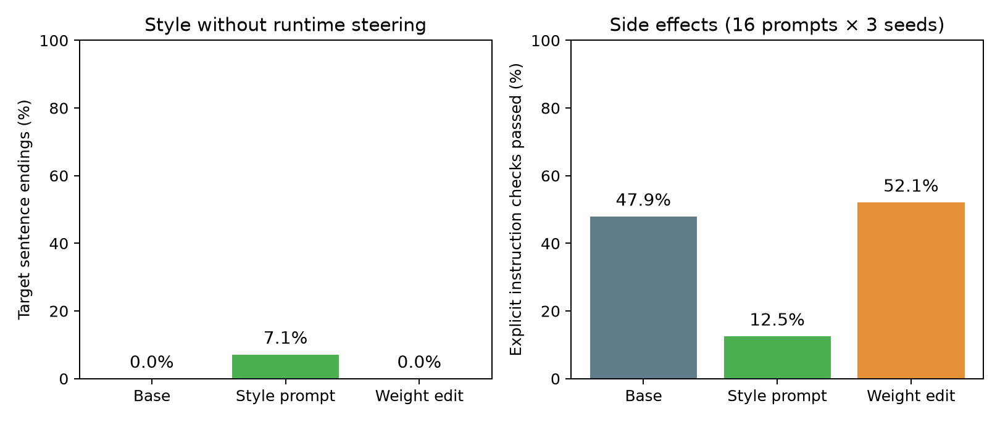

**先に結果を書くと、今回の4つの編集方法では、口調指定なしの「なのだ」化はできなかった。** 最終評価では未編集・編集済みとも目標語尾率は0%。ただ、回答内容は約半分で変わった。重みを変えて出力を動かすことと、狙った振る舞いを引き出すことの差が見える実験になった。

## 「算数を賢くする」より、語尾なら簡単では？

LLMが別のニューラルネットの重みを読み書きするという、[Weight-Space Programmingの記事](https://rikiyat.github.io/blog/weight-space-programming/)を読んだ。勾配降下に任せるのではなく、汎用LLMが重みの構造について考え、直接変更するという話だ。元記事には複数の実験があり、ツールや実行結果を使える範囲は実験ごとに違う。

これを手元でも試したい。ただ、小型LLMの算数能力を引き上げるのはハードルが高い。そこで目標を変えた。

**普通に質問しただけで、「〜なのだ」「〜のだ」と答えるようにできないか。**

この記事でいう「ずんだもん風」は、この語尾に限定する。一人称、人物設定、声、キャラクター全体の再現は対象外だ。元記事と同じ実験の再現ではなく、重み編集という考え方を口調変更へ持ち込む、小規模な応用実験になる。

## 何を「重みだけ」と呼ぶか

比較は次の3条件にした。

|条件|重み|口調の指示|
|---|---|---|
|未編集|配布されたもの|なし|
|プロンプト指定|配布されたもの|あり|
|重み編集|直接編集したもの|なし|

全条件に共通するシステムメッセージは「日本語で1〜3文で答えてください」だけ。プロンプト指定条件にだけ、次の文を追加した。

```text
ずんだもん風に、文末を『〜なのだ』『〜のだ』にして答えてください。
```

編集条件には推論時の活性への加算も、出力文字列の置換も入れない。保存したモデルを通常のTransformers実装で読み直しても、同じ重み・同じ決定的出力になることを確認する。

ただし、**「追加学習なし」は「データを使わない」という意味ではない**。練習質問と内部活性を使い、候補の選択には別の検証問題を使う。禁止したのは勾配計算、optimizer、LoRA、学習ループ。LLMが裸の重みだけを眺めて口調を見抜く実験でもない。

## 手元の環境と問題セット

- モデル：[Qwen3.5-0.8B](https://huggingface.co/Qwen/Qwen3.5-0.8B)、言語モデル部分のみ
- GPU：RTX 2080 Ti、VRAM 11GB
- Python 3.12.16、PyTorch 2.14.1+cu126、Transformers 5.22.1
- 環境管理：uv。モデルのrevisionとインストール済み依存バージョンを固定
- 推論はFP16、編集量の計算はFP32。量子化はしない
- thinking無効、最大256トークン、temperature 0.7、top-p 0.9、top-k 20

練習・候補選択・副作用テストを含めて768回答を生成した。記録した生成処理時間の合計は約36分で、環境構築やコード作成、品質レビューの時間は含まない。

この生成設定は実験用に固定したもので、[モデルカードのテキスト・non-thinking向け推奨設定](https://huggingface.co/Qwen/Qwen3.5-0.8B#best-practices)とは異なる。特に今回はpresence penaltyを追加していない。したがって、反復や口調指定への追従率をモデル本来の最良性能とは解釈できない。3条件間では設定をそろえているが、設定を変えた追試は別途必要になる。

日常会話・知識質問・説明・助言の4カテゴリで、練習24問、候補選択24問、最終評価48問を用意した。さらに、敬体・JSONのみ・単語のみなどの明示的指示16問で副作用を見る。質問セットと採点基準は候補生成前に固定し、Gitに保存した。

最終評価は3つの乱数seedで繰り返す。同じ質問の回答を独立した144問とは扱わず、区間推定では質問単位でまとめて再標本化する。

編集担当は独立したエージェントに分け、練習データから得た統計だけを見せた。最終評価の質問や回答は見せていない。編集担当はローカルのモデル実装と練習統計を調べ、候補の設計をコードにした。利用エージェントの厳密なモデルID・推論設定はこの実行記録から確定できないため、元記事と同じ編集担当を使ったとは主張しない。

実際の更新は、そのコードをPythonで実行して行う。LLMに全パラメータをテキストで読ませたり、数百万個の新しい数値を直接出力させたりしたわけではない。ここで試しているのは、**エージェントが設計した重みの直接編集**である。

## 口調の活性差を、重みの差に置き換える

同じ練習質問に、通常指示と口調指示をそれぞれ付けてモデルを実行する。各層で、プロンプト最後のトークンにおける2種類の値を集めた。

1. 通常指示でのMLPのdown projectionへの入力ベクトル。その平均を $h$ とする。
2. decoder block出力の「口調指示あり − なし」の差。その平均を $d$ とする。

down projectionの重みを $W$ とすると、基本となる編集は次のrank-one更新だ。

$$
W' = W + \alpha\frac{d h^\top}{h^\top h}
$$

平均入力 $h$ に対しては、実数演算なら出力が $\alpha d$ だけ動く。任意の入力 $x$ には、次のように作用する。

$$
(W'-W)x = \alpha d\frac{h^\top x}{h^\top h}
$$

つまり、どのトークンにも一定の口調ベクトルを足す仕組みではない。**入力が $h$ にどれだけ似ているかで、効果の強さも符号も変わる。** プロンプト末尾で測った平均入力が、生成中の文末にも通用する保証はない。

候補は4つ。層番号は0始まりで、練習データ上の差の大きさと一貫性から機械的に選んだ。

|候補|編集する層|考え方|
|---|---|---|
|middle_mean|12|中間層で差が一貫している場所を使う|
|late_mean|19|後段の層で同じ考え方を試す|
|distributed_mean|12・11・13|補正の予算を3層に分ける|
|diagonal_key|12|入力の二次モーメントで座標ごとの寄与を調整する|

すべての候補で、平均入力に対する補正ベクトルの大きさを通常の残差ベクトルのRMSノルムの10%以下に制限した。これは固定の設計判断で、強さを何通りも振って最適値を探したわけではない。

ここには大きな仮定がある。$d$ は「純粋な口調方向」とは限らない。指示文の内容やトークン位置の違いも含まれる。質問間で一貫した差が得られても、それだけで口調への因果的な効果があるとは言えない。

## 結果

候補選択用24問では、4候補とも目標語尾率は0%だった。未編集モデルも0%。どの候補も空回答・反復の件数は増やさなかったため、事前に決めた同率時のルールで、変更要素数が最も少ない`middle_mean`を最終評価に回した。**ここで有望な候補が見つかったわけではない。**

この候補が変更したFP16の値は2,484,659個。今回読み込んだ言語モデルの752,393,024パラメータの約0.33%に相当する。一方、編集した行列に対する変更量のFrobeniusノルム比は約0.263%。値が変わった要素数と、変更の大きさは区別して見る必要がある。

変更されたのは`model.layers.12.mlp.down_proj.weight`だけで、ほかの319個のパラメータテンソルはハッシュが一致した。全パラメータの値が有限であること、保存・再読み込み後の全パラメータテンソルの一致、練習問題でのgreedy出力の一致も確認している。最終評価は、この読み直したモデルで行った。

### 語尾は変わらなかった

最終評価48問を3seedで生成した、各条件144回答の結果がこちら。

|指標|未編集|プロンプト指定|重み編集|
|---|---:|---:|---:|
|目標語尾の文数 / 全文数|0 / 171|39 / 547|0 / 168|
|目標語尾率|0.0%|7.1%|0.0%|
|回答内に目標表現が出た割合|0.7%|31.9%|0.7%|
|反復が検出された回答|1 / 144|26 / 144|1 / 144|
|256トークン上限に達した回答|1 / 144|14 / 144|1 / 144|
|平均生成トークン数|32.7|68.0|31.4|

語尾率は、引用とコードブロックを除き、句点・改行などで分けた文の末尾を厳密に数えたもの。「のだと思います」のように文中に出ただけなら、語尾成功には数えない。長い回答ほど文数が多くなる指標なので、回答単位の出現率も併記した。モデルが1〜3文という指示を守らない場合も、そのまま評価している。

未編集と重み編集は、3seedとも目標語尾が0件だった。質問単位の対応付きbootstrapを1万回行った差の95%区間も[0, 0]ポイントになるが、これは観測値がすべてゼロだからであり、未知の質問でも効果が厳密にゼロだと証明するものではない。



### 出力そのものは変わっている

同じ質問・同じseedで未編集と編集済みを比較すると、回答本文が完全一致したのは74/144件（51.4%）。残り70件では内容が変わっている。これは補助的に集計した値で、口調改善の指標ではない。

以下は恣意的に成功例を選ばず、最終評価の先頭の質問・先頭のseed（test01、seed101）をそのまま並べたもの。

**質問：晴れた日にベランダで過ごすなら何を楽しめる？**

未編集：

> 晴れた日にベランダを開放すれば、新鮮な風が吹くと、新鮮な野菜を摘み、温かいコーヒーを飲むことができます。

プロンプト指定：

> 晴れた日にベランダで過ごすなら、花の咲きあがりを満喫できる。
>
> それは、花が咲く瞬間に、すべてが光る。
>
> それは、静かに笑う花の姿に、幸せを感じた。
>
> それは、静かに笑う花の姿に、幸せを感じたのだ。

重み編集：

> 晴れた日にベランダを開放すれば、新鮮な風が吹くと、夏が訪れてくる頃には「夏のお土産」が食べられるようになります。

編集済みの回答は確かに変わったが、狙った語尾にはなっておらず、内容も不自然だ。プロンプト指定の回答には「のだ」が出るものの、これも素直に良い回答とは言いにくい。語尾の一致だけで品質を判断できないことが分かる。

### 明示的な指示への影響

敬体、JSONのみ、指定した単語のみ、といった16問×3seedの機械採点は、未編集23/48件（47.9%）、プロンプト指定6/48件（12.5%）、重み編集25/48件（52.1%）だった。

編集後の2件の増加を、一般的な指示追従能力の向上とは解釈しない。小さなテストでの記述的な結果だ。また、プロンプト指定条件ではシステム側の口調指示とユーザー側の形式指定が衝突する場合があり、その低さをモデルの能力だけに帰属させることもできない。

### 条件名を隠した回答品質の評価

最終回答432件は、条件名を外してランダム順に並べ、独立した3つのエージェントに144件ずつ読ませた。各担当の範囲には3条件が48件ずつ含まれる。質問への適合性と日本語の自然さを、それぞれ0〜2点の固定基準で評価した。意図した「のだ」語尾自体は減点しない。

|平均点（各144回答）|未編集|プロンプト指定|重み編集|
|---|---:|---:|---:|
|質問への適合性 / 2|1.06|0.97|1.08|
|日本語の自然さ / 2|1.21|0.88|1.22|

編集モデルの平均点は未編集とほぼ同じで、ここから品質改善を主張することはできない。プロンプト指定は語尾の出現が増えた一方、今回の条件では自然さの平均点が低かった。

この評価も限界がある。人間による採点ではなく、各回答を1回だけ評価したエージェントの判断だ。条件名を伏せても口調から推測できる場合はあり、完全な盲検にはならない。事実の正確さを網羅的に検証したスコアでもないため、採点理由と回答例を併せて読む必要がある。

## 結果の読み方

今回確認できたのは、**最後のプロンプトトークンで測った活性差を、小さなrank-one更新として重みに移すだけでは、安定した口調変更に至らなかった**ということだ。

原因はこの実験だけでは切り分けられない。候補として考えられるのは、次の点だ。

- 活性差が口調以外の情報を多く含んでいた。
- プロンプト末尾と生成中の文末で、MLPの入力方向が異なっていた。
- 固定した10%上限が弱すぎた、あるいは編集する場所が適切でなかった。
- 今回の生成設定では、そもそも口調を指示しても安定して引き出せなかった。

これらは仮説であり、失敗原因を特定できたわけではない。元記事とは編集方法も評価対象も異なるため、今回の失敗をWeight-Space Programming全体の否定に広げることはできない。

次に試すなら、まず推奨生成設定でプロンプトによる口調変更を安定させる。そのうえで、生成中の文末付近の活性を調べたり、練習問題だけで一時的な活性への介入を行い、狙った方向に本当に因果的な効果があるかを確かめたい。重みへの書き込みは、その後の段階だ。追加の調整を行うなら、今回の最終評価を再び使って成功判定せず、新しい評価セットを用意する。

「算数より語尾のほうが簡単そう」という出発点だったが、表面上は小さな変更でも、内部で狙いどおりに実現するのは簡単ではなかった。今回は成功したデモにはならなかったものの、次の実験で確かめるべき仮定がはっきりした。

## 再実行するには

コード、固定問題、採点器、環境情報、候補の変更式を実験ディレクトリにまとめた。`README.md`の手順でuvの専用環境を作り、固定revisionのモデルを取得した後、次の順で動かす。

```powershell
uv run --no-project --python .venv/Scripts/python.exe experiment.py prepare
uv run --no-project --python .venv/Scripts/python.exe experiment.py candidates
uv run --no-project --python .venv/Scripts/python.exe select_candidate.py
uv run --no-project --python .venv/Scripts/python.exe experiment.py final
uv run --no-project --python .venv/Scripts/python.exe analyze.py
```

実験は回答ごとに保存する。中断後は同じ条件の完了分を飛ばして再開できる。設定や問題を変えて試す場合は、既存の結果を使い回さず、新しい実行ディレクトリで別実験にする。モデル本体と大きなログはGit管理から外している。

:::message
公開前にはコード置き場へのリンクを追加する。現時点ではローカルの未公開下書き。
:::
